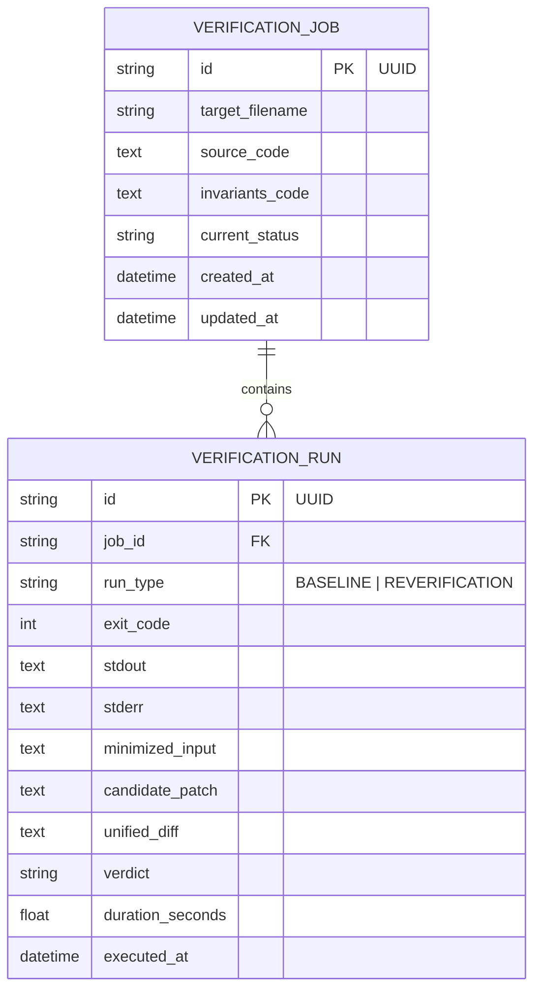

# RESQ Dev — System Architecture & Technical Specification

> **Component Specification & Interface Contracts**  
> Status: Authoritative Architecture Reference  
> Parent Document: [PROJECT_CONTEXT.md](file:///c:/Users/akshitha/Desktop/RESQ_Dev/PROJECT_CONTEXT.md)

---

## 1. System Block Diagram & Data Flow

RESQ Dev is architected with a decoupled pipeline where execution isolation, verification logic, model synthesis, persistence, and presentation are strictly segregated.

```mermaid
flowchart TD
    subgraph UI_Layer [Frontend Layer]
        UI[Streamlit Dashboard]
    end

    subgraph API_Layer [API & Orchestration Layer - Milestone 3]
        API[FastAPI Gateway]
        DB[(SQLite State Store)]
    end

    subgraph Core_Engine [Verification Core - Milestone 1 Independent]
        Pipe[Verification Pipeline]
        Analyzer[Failure Analyzer]
        Applier[AST Patch Applier]
    end

    subgraph Isolation_Layer [Execution Boundary]
        Worker[Docker Execution Runner]
        Container[(Docker Sandbox: resq-sandbox:latest)]
    end

    subgraph Intelligence_Layer [Synthesis Gateway]
        Gateway[LLM Provider Interface]
        MockProv[MockLLMProvider]
        RealProv[Replaceable Real Provider]
    end

    %% Interactions
    UI -->|HTTP / JSON| API
    API -->|Read/Write State| DB
    API -->|Dispatch Job| Pipe
    
    Pipe -->|1. Run Tests| Worker
    Worker -->|Execute in Temp Mount| Container
    Container -->|Stdout, Stderr, Exit Code| Worker
    Worker -->|ExecutionResult| Pipe
    
    Pipe -->|2. Parse Crash| Analyzer
    Analyzer -->|FailureArtifact| Pipe
    
    Pipe -->|3. Request Patch (Bounded Cycle)| Gateway
    Gateway -.-> MockProv
    Gateway -.-> RealProv
    Gateway -->|CandidatePatch| Pipe
    
    Pipe -->|4. Validate AST & Apply to Temp Copy| Applier
    Applier -->|Unified Diff & Patched Temp Dir| Pipe
    
    Pipe -->|5. Re-run Tests on Patched Copy| Worker
    Worker -->|Verify Exit Code 0| Pipe
    Pipe -->|6. Record Final Verdict| DB

    %% Human Review Boundary
    DB -.->|Poll Results & Diff| UI
    UI ==>|7. Explicit Human Review & Manual Export| Human[Developer Decision: Accept or Discard]
```

---

## 2. Component Specifications

### 2.1 Execution Worker (`src/resq/execution/`)
* **Interface Contract:** `ExecutionEnvironment` (Abstract Base Class).
  ```python
  class ExecutionEnvironment(ABC):
      @abstractmethod
      def execute(self, workspace_path: Path, command: list[str], timeout_seconds: int) -> ExecutionResult:
          """Executes a command inside the isolated environment."""
          pass
  ```
* **Primary Implementation:** `DockerExecutionRunner`
  - Spawns an ephemeral container using `resq-sandbox:latest`.
  - Mounts strictly one temporary directory to `/workspace:rw`.
  - Flags enforced:
    - `--rm`: Auto-cleanup container upon process exit.
    - `--network none`: Complete network cutoff; no external or local network sockets.
    - `--memory 512m --memory-swap 512m`: Hard physical RAM and swap ceiling.
    - `--cpus 1.0`: Caps CPU allocation to single core.
    - `--pids-limit 64`: Thwarts process fork bombs.
    - `--read-only`: Root filesystem is mounted read-only.
    - `--user 10001:10001`: Execution as non-root user `resquser`.
    - `--cap-drop ALL`: Drops all Linux kernel capabilities.
* **Host Timeout & Cleanup Guarantee:**
  - Docker's `--stop-timeout` only defines the delay between `SIGTERM` and `SIGKILL` *when* a stop is invoked. It is **not** an execution deadline.
  - The host runner implements the true execution deadline via `subprocess.run(..., timeout=timeout_seconds)`.
  - On timeout expiration (`subprocess.TimeoutExpired`), the host runner catches the exception and immediately executes in a `finally` block:
    ```python
    subprocess.run(["docker", "kill", container_name], capture_output=True)
    subprocess.run(["docker", "rm", "-f", container_name], capture_output=True)
    ```
  - This guarantees zero orphaned containers on the Windows host.
* **No Unsandboxed Fallback:** If Docker is not running or fails to initialize, the runner raises `INFRASTRUCTURE_ERROR`. It **never** executes untrusted user code or AI patches directly on the host machine.

---

### 2.2 Verification Core (`src/resq/engine/`)
The core verification engine operates as a standalone Python library:
1. **`FailureAnalyzer`:**
   - Ingests raw `ExecutionResult` (stdout, stderr, exit code).
   - If exit code is 0: Returns `NO_FAILURE_FOUND`.
   - Parses pytest and Hypothesis outputs to extract:
     - `failing_input`: Minimized example (e.g. `x = 0`, `s = '\x00'`).
     - `exception_type`: Exception class (e.g. `ZeroDivisionError`, `AssertionError`).
     - `traceback_raw`: Complete un-truncated stack trace.
     - `seed`: Hypothesis random seed, enabling deterministic local reproduction.
   - If exit code is non-zero but output is corrupted, non-deterministic, or unparseable: Returns `INSUFFICIENT_EVIDENCE`.
2. **`PatchApplier` & Immutability Architecture:**
   - Candidate patches are strings containing Python code or unified diffs.
   - **Step 1 (AST Safety Gate):** Ingested patch is parsed via `ast.parse()`. If syntax is invalid, immediately returns `REJECTED_SYNTAX_ERROR` without touching any filesystem.
   - **Step 2 (Isolated Workspace Creation):** Creates a dedicated ephemeral directory (`patch_temp_dir`). Copies `target.py` into `patch_temp_dir/target.py`.
   - **Step 3 (Patch Application):** Applies the candidate code to `patch_temp_dir/target.py`.
   - **Step 4 (Diff Synthesis):** Uses Python's standard `difflib.unified_diff()` to generate a clean, colored unified diff between original and patched files.
   - **Step 5 (Original Source Immutability):** The original source file on the host is read-only. Even if the patch is rejected, the original file is mathematically untouched (verified via SHA-256 hash assertions in testing).
3. **`VerificationPipeline` (Bounded Repair & Supervision Orchestrator):**
   - Coordinates the single execution workflow: Baseline Test -> Parse Crash -> Request Patch -> Validate AST -> Apply to Temp Copy -> Re-verify in Docker.
   - **Bounded Repair Budget:** Controlled by `max_repair_cycles: int = 1` (configurable via settings, hard capped at 2).
   - **Zero Autonomous Looping:** If re-verification yields `REJECTED_STILL_FAILS` or `REJECTED_REGRESSION`, and the single retry budget is enabled, it attempts at most one refinement with the updated failure context. Once the budget reaches 0, the pipeline halts immediately.
   - **Audit Visibility:** Every cycle is logged as a separate `VerificationRun` in SQLite, showing exact inputs, outputs, diffs, and verdicts.
   - **No Autonomous Git Operations:** The pipeline has zero Git integration code. It produces diff artifacts for the developer, never committing, merging, or pushing.

---

### 2.3 LLM Gateway (`src/resq/llm/`)
* **Interface Contract:** `LLMProvider`
  ```python
  class LLMProvider(ABC):
      @abstractmethod
      def generate_patch(self, source_code: str, failure: FailureArtifact) -> CandidatePatch:
          """Synthesizes a proposed patch given the code and failure evidence."""
          pass
  ```
* **Implementations:**
  - `MockLLMProvider`: Deterministic offline provider for Milestone 1 vertical slice and integration tests. Returns hardcoded valid/invalid patches matching benchmark fixtures.
  - `RealLLMProvider`: Added in Milestone 2. Replaceable adapter calling an external AI API (e.g., Gemini, OpenAI, Anthropic). Enforces structured JSON output schema and handles API timeouts/rate-limits as `LLM_ERROR`.

---

### 2.4 State Store & Database Schema (`src/resq/database.py` - Milestone 3)
Implemented via SQLite using synchronous SQLAlchemy:



---

### 2.5 REST API Specifications (`src/resq/api/` - Milestone 3)

| Endpoint | Method | Request Payload | Response | Description |
| :--- | :--- | :--- | :--- | :--- |
| `/api/v1/health` | `GET` | None | `{"status": "ok", "docker_available": bool}` | Health and infrastructure check |
| `/api/v1/jobs` | `POST` | `JobCreateRequest` (`source_code`, `invariants_code`) | `202 Accepted` + `JobSummaryResponse` (`job_id`, `status: PENDING`) | Submits target module and dispatches background verification |
| `/api/v1/jobs/{job_id}` | `GET` | None | `JobDetailResponse` (status, runs, artifacts, diff, final verdict) | Polls verification status and retrieves reproducible evidence |

---

## 3. Job Lifecycle State Machine

A verification job transitions strictly through this deterministic state machine:

```mermaid
stateDiagram-v2
    [*] --> PENDING
    PENDING --> RUNNING_BASELINE: Dispatched to Docker
    
    RUNNING_BASELINE --> NO_FAILURE_FOUND: Exit Code 0
    RUNNING_BASELINE --> INSUFFICIENT_EVIDENCE: Exit Code != 0 but unparseable
    RUNNING_BASELINE --> TIMEOUT_EXCEEDED: Host timeout expired
    RUNNING_BASELINE --> INFRASTRUCTURE_ERROR: Docker daemon down
    
    RUNNING_BASELINE --> FAILURE_CAPTURED: Minimized input & trace extracted
    
    FAILURE_CAPTURED --> SYNTHESIZING_PATCH: Call LLM Gateway
    SYNTHESIZING_PATCH --> LLM_ERROR: API failure / timeout
    SYNTHESIZING_PATCH --> PATCH_PROPOSED: Candidate patch received
    
    PATCH_PROPOSED --> REJECTED_SYNTAX_ERROR: ast.parse() fails
    PATCH_PROPOSED --> REVERIFYING: AST valid; applied to temp copy
    
    REVERIFYING --> REJECTED_STILL_FAILS: Reproducer fails in Docker
    REVERIFYING --> REJECTED_REGRESSION: Baseline test fails in Docker
    REVERIFYING --> TIMEOUT_EXCEEDED: Container timeout on patch
    REVERIFYING --> VERIFIED: Exit code 0 on all tests
    
    NO_FAILURE_FOUND --> [*]
    INSUFFICIENT_EVIDENCE --> [*]
    TIMEOUT_EXCEEDED --> [*]
    INFRASTRUCTURE_ERROR --> [*]
    LLM_ERROR --> [*]
    REJECTED_SYNTAX_ERROR --> [*]
    REJECTED_STILL_FAILS --> [*]
    REJECTED_REGRESSION --> [*]
    VERIFIED --> [*]
```



---

## 4. Key Architectural Trade-Offs

1. **Docker Execution vs. Host Subprocess on Windows:**
   - *Trade-off:* Docker introduces startup latency (~1-2 seconds per container run) and dependency on Docker Desktop.
   - *Rationale:* Running untrusted Python code directly in a Windows subprocess provides zero filesystem or network isolation. The latency cost is necessary to maintain technical integrity and security.
2. **Synchronous In-Process Background Dispatch vs. Celery/Redis:**
   - *Trade-off:* In-process execution cannot scale across multiple compute nodes.
   - *Rationale:* For a single-user hackathon tool, distributed message brokers add unnecessary operational complexity. SQLite + FastAPI background task dispatch provides clean, non-blocking asynchronous behavior with zero external services.
3. **AST Validation Before Filesystem Operations:**
   - *Trade-off:* Requires LLM output to be pure Python (or extracted from markdown).
   - *Rationale:* Parsing AST immediately prevents executing corrupt files and protects disk integrity.
4. **Human-in-the-Loop Supervision vs. Autonomous Self-Healing:**
   - *Trade-off:* Requires developer interaction to review evidence and manually integrate verified diffs.
   - *Rationale:* Completely prevents catastrophic risks of automated repository corruption, hallucinated code reaching production branches, or unintended deletions. Verification proves evidence in a sandbox; developer discretion governs production codebases.
