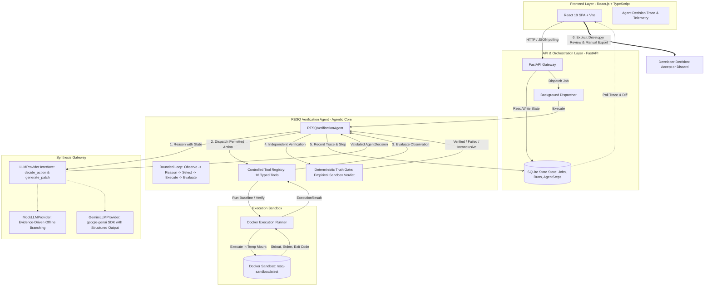
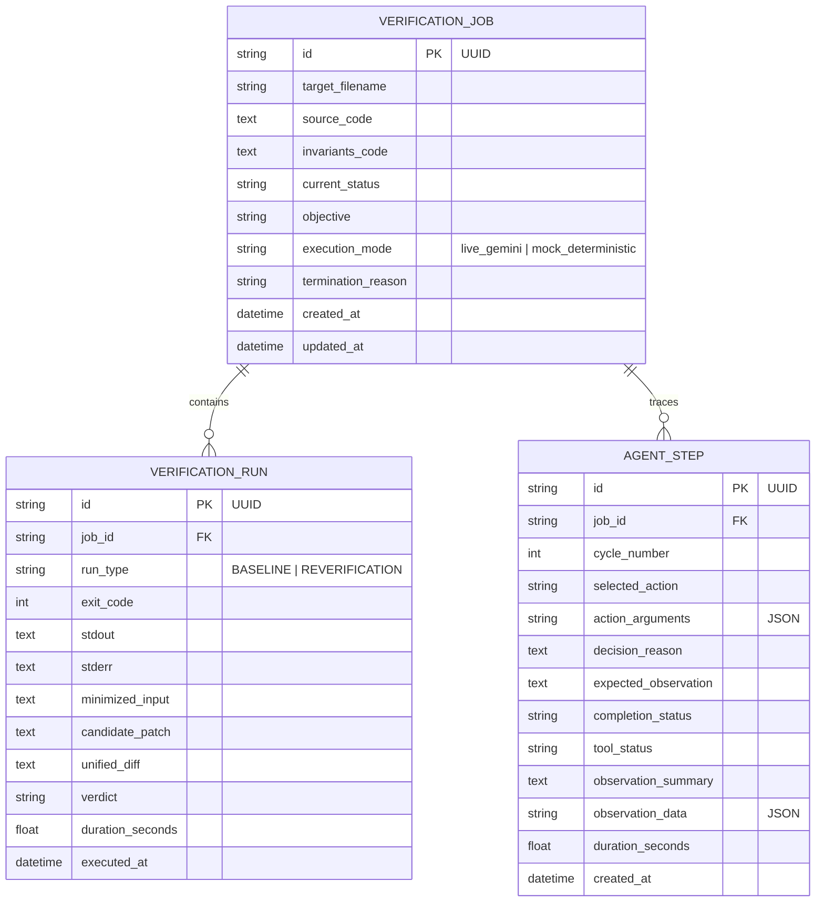

# RESQ Dev — System Architecture & Technical Specification

> **Component Specification & Interface Contracts**  
> Status: Authoritative Architecture Reference  
> Parent Document: [PROJECT_CONTEXT.md](file:///c:/Users/akshitha/Desktop/RESQ_Dev/PROJECT_CONTEXT.md)

---

## 1. System Block Diagram & Data Flow

RESQ Dev is architected with a decoupled pipeline where execution isolation, verification logic, model synthesis, persistence, and presentation are strictly segregated.



---

## 2. Component Specifications

### 2.1 Execution Worker (`src/resq/execution/`)
* **Interface Contract:** `ExecutionEnvironment` (Abstract Base Class).
  ```python
  class ExecutionEnvironment(ABC):
      @abstractmethod
      def execute(self, workspace_path: Path, command: list[str], timeout_seconds: int) -> ExecutionResult:
          """Executes a command inside the isolated environment."""
          pass
  ```
* **Primary Implementation:** `DockerExecutionRunner`
  - Spawns an ephemeral container using `resq-sandbox:latest`.
  - Mounts strictly one temporary directory to `/workspace:rw`.
  - Flags enforced:
    - `--rm`: Auto-cleanup container upon process exit.
    - `--network none`: Complete network cutoff; no external or local network sockets.
    - `--memory 512m --memory-swap 512m`: Hard physical RAM and swap ceiling.
    - `--cpus 1.0`: Caps CPU allocation to single core.
    - `--pids-limit 64`: Thwarts process fork bombs.
    - `--read-only`: Root filesystem is mounted read-only.
    - `--user 10001:10001`: Execution as non-root user `resquser`.
    - `--cap-drop ALL`: Drops all Linux kernel capabilities.
* **Host Timeout & Cleanup Guarantee:**
  - Docker's `--stop-timeout` only defines the delay between `SIGTERM` and `SIGKILL` *when* a stop is invoked. It is **not** an execution deadline.
  - The host runner implements the true execution deadline via `subprocess.run(..., timeout=timeout_seconds)`.
  - On timeout expiration (`subprocess.TimeoutExpired`), the host runner catches the exception and immediately executes in a `finally` block:
    ```python
    subprocess.run(["docker", "kill", container_name], capture_output=True)
    subprocess.run(["docker", "rm", "-f", container_name], capture_output=True)
    ```
  - This guarantees zero orphaned containers on the Windows host.
* **No Unsandboxed Fallback:** If Docker is not running or fails to initialize, the runner raises `INFRASTRUCTURE_ERROR`. It **never** executes untrusted user code or AI patches directly on the host machine.

---

### 2.2 Verification Core (`src/resq/engine/`)
The core verification engine operates as a standalone Python library:
1. **`FailureAnalyzer`:**
   - Ingests raw `ExecutionResult` (stdout, stderr, exit code).
   - If exit code is 0: Returns `NO_FAILURE_FOUND`.
   - Parses pytest and Hypothesis outputs to extract:
     - `failing_input`: Minimized example (e.g. `x = 0`, `s = '\x00'`).
     - `exception_type`: Exception class (e.g. `ZeroDivisionError`, `AssertionError`).
     - `traceback_raw`: Complete un-truncated stack trace.
     - `seed`: Hypothesis random seed, enabling deterministic local reproduction.
   - If exit code is non-zero but output is corrupted, non-deterministic, or unparseable: Returns `INSUFFICIENT_EVIDENCE`.
2. **`PatchApplier` & Immutability Architecture:**
   - Candidate patches are strings containing Python code or unified diffs.
   - **Step 1 (AST Safety Gate):** Ingested patch is parsed via `ast.parse()`. If syntax is invalid, immediately returns `REJECTED_SYNTAX_ERROR` without touching any filesystem.
   - **Step 2 (Isolated Workspace Creation):** Creates a dedicated ephemeral directory (`patch_temp_dir`). Copies `target.py` into `patch_temp_dir/target.py`.
   - **Step 3 (Patch Application):** Applies the candidate code to `patch_temp_dir/target.py`.
   - **Step 4 (Diff Synthesis):** Uses Python's standard `difflib.unified_diff()` to generate a clean, colored unified diff between original and patched files.
   - **Step 5 (Original Source Immutability):** The original source file on the host is read-only. Even if the patch is rejected, the original file is mathematically untouched (verified via SHA-256 hash assertions in testing).
3. **`RESQVerificationAgent` (Autonomous Verification Loop):**
   - Implements a bounded evidence-driven control loop:
     `OBSERVE -> REASON -> SELECT ACTION -> EXECUTE TOOL -> EVALUATE RESULT -> UPDATE STATE -> CONTINUE OR STOP`
   - Governed by hard budget limits: `agent_max_cycles` (default 8) and `agent_max_tool_calls` (default 12).
   - Dynamically selects actions from a strictly registered, schema-validated tool interface based on accumulated failure evidence and intermediate execution results.
   - Evaluates verdicts strictly via an independent `DeterministicTruthGate` rather than model assertions.
4. **`ToolRegistry` (Narrow Typed Interface):**
   - Exposes 10 permitted verification tools:
     1. `inspect_source`: Reads target Python source code within safe line bounds.
     2. `inspect_tests`: Inspects invariants and test files.
     3. `run_baseline_tests`: Executes initial tests in Docker sandbox with timeout enforcement.
     4. `analyze_failure`: Parses stack traces, failure categories, and minimized counterexamples.
     5. `inspect_ast`: Extracts AST node summaries, functions, and import trees.
     6. `run_hypothesis_analysis`: Ingests property-based testing feedback.
     7. `generate_candidate_patch`: Prompts the LLM provider for a candidate fix.
     8. `validate_candidate_patch`: Enforces AST parse syntax checks before touching disk.
     9. `run_verification_tests`: Executes tests against the temporary patched copy in Docker.
     10. `summarize_evidence`: Synthesizes final verification evidence bundle.
   - Enforces strict argument validation, output size ceilings (64 KiB), and rejects unregistered or unsafe commands.
5. **`VerificationPipeline` (Compatibility Adapter):**
   - Seamlessly delegates execution to `RESQVerificationAgent` while preserving the exact Milestone 0-5 API signature (`run(...)`) and populating `job.runs` alongside granular `agent_steps`.

---

### 2.3 LLM Gateway (`src/resq/llm/`)
* **Interface Contract:** `LLMProvider`
  ```python
  class LLMProvider(ABC):
      @abstractmethod
      def generate_patch(self, source_code: str, failure: FailureArtifact) -> CandidatePatch:
          """Synthesizes a proposed patch given the code and failure evidence."""
          pass

      @abstractmethod
      def decide_action(self, state: AgentState) -> AgentDecision:
          """Evaluates agent state and selects next tool action."""
          pass
  ```
* **Implementations:**
  - `MockLLMProvider`: Offline, deterministic provider. Implements evidence-driven dynamic branching (adapts choices based on observed test failures, syntax errors, and missing evidence) and supports deterministic `decision_sequence` injection for testing.
  - `GeminiLLMProvider`: Live AI provider using the official `google-genai` SDK (`gemini-2.5-flash`). Enforces structured output via Pydantic schema (`StructuredDecisionResponse`), with robust error handling and fallback.

---

### 2.4 State Store & Database Schema (`src/resq/database.py`)
Implemented via SQLite using synchronous SQLAlchemy:



---

### 2.5 REST API Specifications (`src/resq/api/`)

| Endpoint | Method | Request Payload | Response | Description |
| :--- | :--- | :--- | :--- | :--- |
| `/api/v1/health` | `GET` | None | `{"status": "ok", "docker_available": bool}` | Health and infrastructure check |
| `/api/v1/jobs` | `POST` | `JobCreateRequest` (`source_code`, `invariants_code`) | `202 Accepted` + `JobSummaryResponse` (`job_id`, `status: PENDING`) | Submits target module and dispatches background agent verification |
| `/api/v1/jobs/{job_id}` | `GET` | None | `JobDetailResponse` (status, objective, execution_mode, termination_reason, runs, agent_steps, final verdict) | Polls verification status, audit trace, and candidate diff |
| `/api/v1/jobs/{job_id}/trace` | `GET` | None | `{"job_id": str, "objective": str, "steps": List[AgentStepResponse]}` | Dedicated endpoint retrieving granular agent decision cycles |

---

### 2.6 Frontend Architecture (`frontend/` - React 19 + TypeScript)
- **Framework:** React 19 Single Page Application built with Vite.
- **Components:**
  - `Header`: Displays system status, Docker health, and `Agent: Active` indicator.
  - `VerificationView`: Multi-tab inspection panel featuring:
    - **🤖 Agent Decision Trace:** Interactive card feed rendering every decision cycle, selected tool, reasoning, expected observation, tool observation, and evidence badges.
    - **Execution Mode Banner:** Visually distinguishes `🤖 Live Gemini Agentic Loop` from `🛡️ Mock Deterministic Agent Loop`.
    - **Candidate Patch Diff:** Syntax-highlighted unified diff for human developer review.
    - **Verification Runs & Evidence:** Detailed baseline and re-verification execution artifacts.
  - **Human-in-the-Loop Export:** One-click manual diff export; strictly preserves repository immutability.

---

## 3. Job Lifecycle State Machine

A verification job transitions strictly through this deterministic state machine:

```mermaid
stateDiagram-v2
    [*] --> PENDING
    PENDING --> RUNNING_BASELINE: Dispatched to Docker
    
    RUNNING_BASELINE --> NO_FAILURE_FOUND: Exit Code 0
    RUNNING_BASELINE --> INSUFFICIENT_EVIDENCE: Exit Code != 0 but unparseable
    RUNNING_BASELINE --> TIMEOUT_EXCEEDED: Host timeout expired
    RUNNING_BASELINE --> INFRASTRUCTURE_ERROR: Docker daemon down
    
    RUNNING_BASELINE --> FAILURE_CAPTURED: Minimized input & trace extracted
    
    FAILURE_CAPTURED --> SYNTHESIZING_PATCH: Call LLM Gateway
    SYNTHESIZING_PATCH --> LLM_ERROR: API failure / timeout
    SYNTHESIZING_PATCH --> PATCH_PROPOSED: Candidate patch received
    
    PATCH_PROPOSED --> REJECTED_SYNTAX_ERROR: ast.parse() fails
    PATCH_PROPOSED --> REVERIFYING: AST valid; applied to temp copy
    
    REVERIFYING --> REJECTED_STILL_FAILS: Reproducer fails in Docker
    REVERIFYING --> REJECTED_REGRESSION: Baseline test fails in Docker
    REVERIFYING --> TIMEOUT_EXCEEDED: Container timeout on patch
    REVERIFYING --> VERIFIED: Exit code 0 on all tests
    
    NO_FAILURE_FOUND --> [*]
    INSUFFICIENT_EVIDENCE --> [*]
    TIMEOUT_EXCEEDED --> [*]
    INFRASTRUCTURE_ERROR --> [*]
    LLM_ERROR --> [*]
    REJECTED_SYNTAX_ERROR --> [*]
    REJECTED_STILL_FAILS --> [*]
    REJECTED_REGRESSION --> [*]
    VERIFIED --> [*]
```



---

## 4. Key Architectural Trade-Offs

1. **Docker Execution vs. Host Subprocess on Windows:**
   - *Trade-off:* Docker introduces startup latency (~1-2 seconds per container run) and dependency on Docker Desktop.
   - *Rationale:* Running untrusted Python code directly in a Windows subprocess provides zero filesystem or network isolation. The latency cost is necessary to maintain technical integrity and security.
2. **Synchronous In-Process Background Dispatch vs. Celery/Redis:**
   - *Trade-off:* In-process execution cannot scale across multiple compute nodes.
   - *Rationale:* For a single-user hackathon tool, distributed message brokers add unnecessary operational complexity. SQLite + FastAPI background task dispatch provides clean, non-blocking asynchronous behavior with zero external services.
3. **AST Validation Before Filesystem Operations:**
   - *Trade-off:* Requires LLM output to be pure Python (or extracted from markdown).
   - *Rationale:* Parsing AST immediately prevents executing corrupt files and protects disk integrity.
4. **Human-in-the-Loop Supervision vs. Autonomous Self-Healing:**
   - *Trade-off:* Requires developer interaction to review evidence and manually integrate verified diffs.
   - *Rationale:* Completely prevents catastrophic risks of automated repository corruption, hallucinated code reaching production branches, or unintended deletions. Verification proves evidence in a sandbox; developer discretion governs production codebases.
