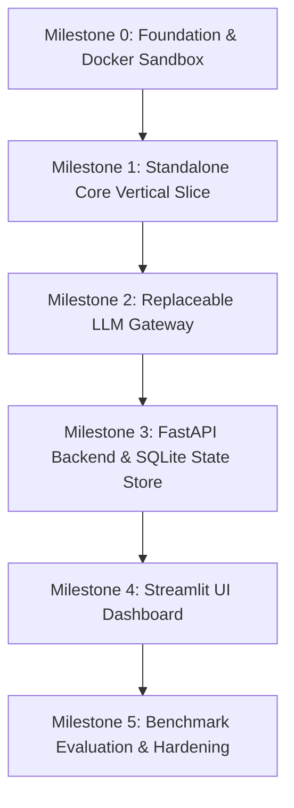

# RESQ Dev — Implementation & Delivery Plan

> **Dependency-Ordered Milestone Delivery Plan**  
> Status: Authoritative Implementation Guide  
> Parent Document: [PROJECT_CONTEXT.md](file:///c:/Users/akshitha/Desktop/RESQ_Dev/PROJECT_CONTEXT.md)

---

## 1. Roadmap Overview & Dependency Graph

RESQ Dev is developed in six sequential, dependency-ordered milestones. Each milestone delivers a testable vertical or horizontal capability with explicit acceptance criteria and rollback protections.



---

## 2. Milestone Specifications

### Milestone 0: Foundation, Domain Models & Docker Sandbox
* **Objective:** Establish the workspace baseline, configure Pydantic settings, build the isolated Docker sandbox image, and define core domain data structures.
* **Deliverables:**
  - `pyproject.toml`: Dependencies (`pydantic`, `pydantic-settings`, `pytest`, `hypothesis`).
  - `.env.example`: Template for configuration variables.
  - `src/resq/config.py`: Configuration models using `pydantic-settings` (Docker image name, timeouts).
  - `src/resq/models.py`: Core domain models (`ExecutionResult`, `FailureArtifact`, `CandidatePatch`, `VerificationVerdict`).
  - `docker/Dockerfile.sandbox`: Minimal `python:3.11-slim` image with `pytest`, `hypothesis`, and unprivileged user `resquser` (`UID 10001`).
  - `docker/build_sandbox.ps1`: Windows PowerShell script to build `resq-sandbox:latest`.
* **Acceptance Criteria:**
  1. `docker/build_sandbox.ps1` completes with exit code 0.
  2. `docker run --rm --network none resq-sandbox:latest pytest --version` succeeds.
  3. `python -c "import resq.config, resq.models; print('Imports valid')"` prints without warnings.
* **Error Handling & Edge Cases:**
  - Docker daemon unavailable: `build_sandbox.ps1` checks for active Docker engine and raises a clear descriptive error.
* **Safe Rollback Procedure:**
  - Targeted file restoration: `git restore pyproject.toml src/resq/config.py src/resq/models.py docker/`.
  - Do NOT run blanket `git clean -fd` to prevent deleting user scratch files or virtual environment caches.
* **Definition of Done:** `resq-sandbox:latest` exists locally, and domain models validate JSON serialization.

---

### Milestone 1: The Standalone Core Vertical Slice
* **Objective:** **The critical hackathon priority.** Prove the full verification loop end-to-end without any web frameworks, databases, or external network APIs.
* **Deliverables:**
  - `src/resq/execution/base.py`: `ExecutionEnvironment` abstract interface.
  - `src/resq/execution/docker_runner.py`: Container runner enforcing `--network none`, `--memory 512m`, `--cpus 1.0`, host-level timeouts, and reliable container cleanup.
  - `src/resq/engine/failure_analyzer.py`: Parser converting pytest/Hypothesis failures into structured `FailureArtifact`; handles `NO_FAILURE_FOUND` and `INSUFFICIENT_EVIDENCE`.
  - `src/resq/engine/patch_applier.py`: AST syntax validator, isolated temporary-directory patcher, unified diff generator, and original-source immutability protector.
  - `src/resq/llm/base.py`: Abstract `LLMProvider` protocol.
  - `src/resq/llm/mock_provider.py`: Deterministic mock provider returning pre-computed valid/invalid patches for benchmark fixtures.
  - `src/resq/engine/pipeline.py`: Pure Python orchestrator coordinating the loop with strictly bounded repair cycles (`max_repair_cycles: int = 1`, max 2).
  - `benchmarks/fixtures/01_off_by_one.py`: Benchmark target with a classic boundary bug and property test.
  - `tests/test_docker_runner.py`: Validates container timeout enforcement, network blocking, and cleanup.
  - `tests/test_patch_applier.py`: Validates AST syntax checks and asserts original file immutability (hash check).
  - `tests/test_pipeline_vertical.py`: End-to-end integration test of the vertical slice and bounded cycle termination.
* **Acceptance Criteria:**
  1. `pytest tests/test_docker_runner.py` verifies that network calls inside the container fail and timeouts kill the container cleanly.
  2. `pytest tests/test_patch_applier.py` confirms rejected patches leave original source file SHA-256 hash identical.
  3. `pytest tests/test_pipeline_vertical.py` runs end-to-end inside Docker, captures the failure from `01_off_by_one.py`, uses the mock patch, re-verifies in Docker, and confirms verdict is `VERIFIED`.
  4. Deliberately broken mock patch yields `REJECTED_STILL_FAILS` or `REJECTED_SYNTAX_ERROR`.
  5. The pipeline strictly respects `max_repair_cycles` and halts upon budget exhaustion without unbounded autonomous retries.
* **Error Handling & Edge Cases:**
  - Infinite loops inside code: Container is killed at host timeout; returns `TIMEOUT_EXCEEDED`.
  - Clean test run: Returns `NO_FAILURE_FOUND`.
  - Corrupt or unparseable pytest output: Returns `INSUFFICIENT_EVIDENCE`.
* **Safe Rollback Procedure:**
  - Targeted file restore: `git restore src/resq/execution/ src/resq/engine/ src/resq/llm/ tests/`.
* **Definition of Done:** `pytest tests/test_pipeline_vertical.py` passes 10 out of 10 consecutive runs.

---

### Milestone 2: Replaceable LLM Gateway & Real Provider Integration
* **Objective:** Connect a real AI provider behind the `LLMProvider` interface to generate candidate patches from failure artifacts.
* **Deliverables:**
  - `src/resq/llm/prompts.py`: System and user prompt templates demanding strict structured JSON output containing the replacement function/diff (zero conversational markdown).
  - `src/resq/llm/real_provider.py`: Replaceable provider adapter (configurable via `LLM_PROVIDER` in `.env`).
  - Unit tests verifying prompt formatting and JSON extraction error handling.
* **Acceptance Criteria:**
  1. Real provider receives `FailureArtifact` and synthesizes candidate patch.
  2. Syntactically invalid code from the LLM is intercepted by `PatchApplier` and recorded as `REJECTED_SYNTAX_ERROR`.
  3. Provider connection failure or rate limits are caught and recorded as `LLM_ERROR` without crashing.
* **Error Handling & Edge Cases:**
  - Markdown fences (` ```python `) in LLM responses are stripped cleanly by the JSON/AST parser.
  - API timeouts return `LLM_ERROR`.
* **Safe Rollback Procedure:**
  - Set `LLM_PROVIDER=mock` in `.env` to instantly revert to deterministic offline execution.
  - Revert code edits: `git restore src/resq/llm/prompts.py src/resq/llm/real_provider.py`.
* **Definition of Done:** The real provider successfully resolves at least one benchmark fixture end-to-end.

---

### Milestone 3: FastAPI Backend & SQLite State Store
* **Objective:** Expose the verification engine via a RESTful API with SQLite persistence.
* **Deliverables:**
  - `src/resq/database.py`: Synchronous SQLite engine and SQLAlchemy tables for `VerificationJob` and `VerificationRun`.
  - `src/resq/api/schemas.py`: Pydantic request/response schemas.
  - `src/resq/api/routes.py`: Endpoints `POST /api/v1/jobs` and `GET /api/v1/jobs/{job_id}`.
  - `src/resq/api/app.py`: FastAPI application entrypoint with CORS and error handlers.
  - `tests/test_api.py`: FastAPI endpoint integration tests using `TestClient`.
* **Acceptance Criteria:**
  1. `POST /api/v1/jobs` accepts source code, schedules verification task, and returns `202 Accepted` with a UUID.
  2. `GET /api/v1/jobs/{job_id}` reflects job state transitions from `PENDING` to terminal verdict (`VERIFIED`, `REJECTED_*`, etc.).
  3. All job runs, failure artifacts, and diffs are persisted in SQLite.
* **Error Handling & Edge Cases:**
  - Missing jobs return `404 Not Found`.
  - Invalid request payloads return `422 Unprocessable Entity`.
* **Safe Rollback Procedure:**
  - Targeted file restore: `git restore src/resq/database.py src/resq/api/ tests/test_api.py`.
* **Definition of Done:** `pytest tests/test_api.py` passes all lifecycle assertions.

---

### Milestone 4: Streamlit Frontend & Interactive Dashboard
* **Objective:** Build an interactive UI for code submission, live stage visualization, diff inspection, and human review/export.
* **Deliverables:**
  - `src/resq/ui/app.py`: Streamlit entrypoint.
  - `src/resq/ui/components.py`: UI components (Execution Timeline, Minimized Failure Evidence Card, Colored Unified Diff Viewer, Status Badge, **Human Review & Manual Patch Export Panel**).
* **Acceptance Criteria:**
  1. User can paste a module or select a pre-packaged benchmark from a dropdown.
  2. Clicking "Run RESQ Verification" displays live progress stages.
  3. Failing input (e.g., `x = 0`) is displayed prominently in an Evidence Card.
  4. Verified patch is displayed as a colored unified diff with an unmistakable green `VERIFIED` badge.
  5. UI provides explicit manual export controls ("Copy Patch", "Download Unified Diff") for human review; **strictly zero** automated repository overwrite, commit, or deployment buttons exist.
* **Error Handling & Edge Cases:**
  - Backend API unreachable: Streamlit displays a clear connection banner with recovery instructions.
* **Safe Rollback Procedure:**
  - Targeted file restore: `git restore src/resq/ui/`.
* **Definition of Done:** The complete user journey is operable in the browser without looking at the terminal.

---

### Milestone 5: Benchmark Evaluation Suite & Hardening
* **Objective:** Curate 4 verified edge-case benchmarks and implement an automated evaluation runner.
* **Deliverables:**
  - `benchmarks/fixtures/01_off_by_one.py` (Boundary index error).
  - `benchmarks/fixtures/02_empty_collection.py` (Unhandled empty sequence / None state).
  - `benchmarks/fixtures/03_unicode_sanitization.py` (Surrogate pairs / null bytes).
  - `benchmarks/fixtures/04_precision_rounding.py` (Floating point accumulation).
  - `benchmarks/run_benchmarks.py`: Evaluation script measuring time-to-reproduce, verification outcome, and patch pass rate.
* **Acceptance Criteria:**
  1. `python benchmarks/run_benchmarks.py` runs all 4 benchmarks through the engine.
  2. Prints a clean, reproducible summary table reporting:
     - Fixture Name
     - Reproducer Discovery (Found / Not Found)
     - Minimized Input Value
     - Patch Verdict (`VERIFIED`)
     - Total Latency (seconds)
* **Error Handling & Edge Cases:**
  - Handles individual benchmark timeouts gracefully without aborting the entire suite.
* **Safe Rollback Procedure:**
  - Targeted file restore: `git restore benchmarks/`.
* **Definition of Done:** Benchmark summary table prints cleanly and matches documented capabilities.
